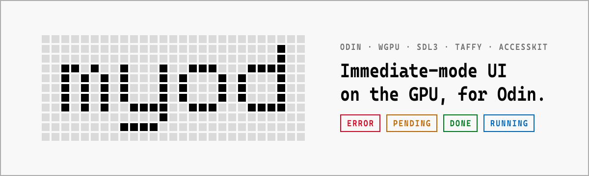

<picture>
  <source media="(prefers-color-scheme: dark)" srcset=".github/readme/banner-dark.svg">
  
</picture>

<p align="center">
  <b>myod</b> is an immediate-mode UI library for <a href="https://odin-lang.org">Odin</a>, rendered on the GPU,<br>
  built for data-heavy desktop software: tables, lists, charts, feeds, and a million rows that scroll smoothly.
</p>

<p align="center">
  
  
  
  
</p>

<p align="center">
  <a href="#quick-start"><b>Quick start</b></a> ·
  <a href="#examples"><b>Examples</b></a> ·
  <a href="#components"><b>Components</b></a> ·
  <a href="DESIGN.md"><b>Design</b></a> ·
  <a href="ARCHITECTURE.md"><b>Architecture</b></a> ·
  <a href="ROADMAP.md"><b>Roadmap</b></a>
</p>

---

## Why myod

<table>
<tr>
<td width="50%" valign="top">

**Immediate mode, Elm-shaped**<br>
`view` redeclares the UI every frame. All state lives in one `State`, every transition is a `Msg` variant, and a message you forget to handle is a compile error.

</td>
<td width="50%" valign="top">

**Zero CPU when idle**<br>
Purely event-driven: no input, no frame. The cursor doesn't blink, and a frame whose draw commands didn't change never reaches the GPU.

</td>
</tr>
<tr>
<td valign="top">

**Pixel-exact by construction**<br>
No corner radius, shadows or gradients. Everything is an axis-aligned rectangle snapped to physical pixels, and self-tests check every pixel at 1×, 1.25×, 1.5× and 2×.

</td>
<td valign="top">

**One pipeline, often one draw call**<br>
Rectangles, glyphs and Phosphor icons share a single instanced pipeline, with an R8 and an RGBA atlas bound at once.

</td>
</tr>
<tr>
<td valign="top">

**Text that takes CJK seriously**<br>
CoreText on macOS, FreeType + HarfBuzz elsewhere. The DWG typeface on a strict 2:1 grid, IME preedit, UAX #14 line breaking, font fallback and color emoji.

</td>
<td valign="top">

**Flexbox and CSS Grid, nested**<br>
[Taffy](https://github.com/DioxusLabs/taffy) runs directly on myod's node array. With subtree reuse and culling, a 5,885-widget form costs **0.08 ms** per frame.

</td>
</tr>
<tr>
<td valign="top">

**A million rows**<br>
Virtual lists and grids with variable row heights, scroll anchoring and stick-to-bottom. A million rows by a hundred thousand columns, and a frame still costs only what's on screen.

</td>
<td valign="top">

**Accessible from day one**<br>
Every widget reaches VoiceOver through [AccessKit](https://github.com/AccessKit/accesskit). Tests find widgets by role and name, the same way a screen reader does.

</td>
</tr>
<tr>
<td valign="top">

**The full shadcn/ui set**<br>
Dialogs, menus, comboboxes, calendars, data tables, a command palette, toasts and charts: the [shadcn/ui](https://ui.shadcn.com) components, in myod's own visual language.

</td>
<td valign="top">

**Clone, then `odin build`**<br>
No Nix, Rust or C toolchain needed. Dependencies ship as prebuilt static libraries, rebuilt byte-for-byte from pinned sources with `just verify`.

</td>
</tr>
</table>

## A taste

The whole app is four parts: `State`, `Msg`, `update` and `view`. This is [`examples/counter`](examples/counter/main.odin):

```odin
State :: struct { count: int }

Increment :: struct {}
Decrement :: struct {}
Reset     :: struct {}
Msg :: union { Increment, Decrement, Reset }

// The only place that modifies state. The switch is exhaustive:
// add a message without handling it and the program doesn't compile.
update :: proc(s: ^State, msg: Msg, fx: ^ui.Effects(Msg)) {
	switch _ in msg {
	case Increment: s.count += 1
	case Decrement: s.count -= 1
	case Reset:     s.count = 0
	}
}

// Receives state by value and can only send messages.
view :: proc(s: State, d: ui.Dispatch(Msg)) {
	// Containers return bool and close themselves at the end of the scope.
	if ui.column({padding = 24, gap = 16, align_x = .Center, align_y = .Center}) {
		ui.text(fmt.tprint(s.count), .Display)

		if ui.row({gap = 8}) {
			if ui.icon_button(ph.MINUS, "减一").clicked do ui.dispatch(d, Decrement{}) // "−1"
			if ui.icon_button(ph.PLUS, "加一").clicked do ui.dispatch(d, Increment{})  // "+1"
			if ui.button("重置", icon = ph.ARROW_COUNTER_CLOCKWISE, variant = .Ghost,    // "Reset"
			             disabled = s.count == 0).clicked {
				ui.dispatch(d, Reset{})
			}
		}
	}
}

main :: proc() {
	window := ui.open_window({title = "计数器", size = {320, 200}})
	defer ui.close_window(&window)

	store: ui.Store(State, Msg)
	ui.store_init(&store, &window, State{}, update)
	defer ui.store_destroy(&store)

	for ui.next_frame(&window) {
		view(store.state, ui.dispatcher(&store))
	}
}
```

**Test it the way a user would.** No window, no GPU, no coordinates: find widgets by role and name in the same semantic tree the screen reader sees, and click them through the real input phase.

```odin
@(test)
counter_clicks :: proc(t: ^testing.T) {
	h := ui.test_harness(State{}, update, view)
	defer ui.test_destroy(h)

	for _ in 0 ..< 3 do ui.test_click(h, .Button, "加一")
	testing.expect_value(t, h.store.state.count, 3)
	testing.expect(t, ui.test_find(h, .Static_Text, "3") != nil)
}
```

<details>
<summary><b>Background work</b>: tasks start in <code>update</code> and talk back with messages</summary>
<br>

Side effects only happen in `update`, through `fx`. A task runs on a thread managed by the library, never touches `State`, and reports progress with `emit`. From [`examples/download`](examples/download/main.odin):

```odin
update :: proc(s: ^State, msg: Msg, fx: ^ui.Effects(Msg)) {
	switch m in msg {
	case Start:    s.job = ui.start_task(fx, download, Download_Args{})
	case Cancel:   ui.cancel_task(fx, s.job) // a request; the task answers with Cancelled
	case Progress: s.progress = f32(m)
	case Done:     s.status = .Done
	// ...
	}
}

download :: proc(t: ^ui.Task_Context(Msg), args: Download_Args) -> Msg {
	for i in 1 ..= 100 {
		if ui.cancelled(t) do return Cancelled{}
		time.sleep(30 * time.Millisecond)
		ui.emit(t, Progress(f32(i) / 100)) // wakes the UI thread
	}
	return Done{}
}
```

`ui.pending_task(s.job, "下载中")` then shows a spinner, the elapsed time and the time since the task last emitted, so a stuck task is visible at a glance.

</details>

## Quick start

> [!NOTE]
> myod is pre-1.0. Prebuilt libraries currently ship for **macOS arm64**; Linux (x86_64, arm64) is in progress, and Windows comes last.

You need the [Odin](https://odin-lang.org) compiler and, optionally, [`just`](https://github.com/casey/just).

```sh
git clone https://github.com/AkaraChen/myod.git
cd myod
just run counter        # or: just run 08_shadcn
```

Without `just`:

```sh
mkdir -p build
odin build examples/counter -collection:myod=. -out:build/counter
./build/counter
```

To use myod in your own project, point a collection at the checkout and import the packages:

```odin
// odin build . -collection:myod=path/to/myod
import ui "myod:ui"
import ph "myod:icons/phosphor"   // all 1,248 Phosphor icons; only the ones you use are embedded
```

The DWG font (about 17 MB per weight) is loaded at runtime from `third_party/fonts/` relative to the working directory. Run from the repository root, or set `MYOD_FONT_DIR`.

## Examples

Each milestone is accepted against a runnable demo. Run any of them with `just run <name>`.

| Example | What it shows |
| --- | --- |
| [`counter`](examples/counter) | The minimal app: `State`, `Msg`, `update`, `view` and the frame loop |
| [`todomvc`](examples/todomvc) | Lists, ID scopes, controlled text input, edit state, filtering |
| [`download`](examples/download) | Background tasks with progress, cancellation and simulated failure |
| [`00_clear`](examples/00_clear) | A window and a test pattern that follow a live edge drag without stretching |
| [`01_rects`](examples/01_rects) | Component shapes drawn from design tokens; the pixel self-test |
| [`02_text`](examples/02_text) | The type scale in mixed Chinese and English, ligatures, fallback, emoji |
| [`02_icons`](examples/02_icons) | Every Phosphor weight at 12 / 16 / 20 / 24 px, duotone, icons inline with text |
| [`02_sprites`](examples/02_sprites) | Box drawing, blocks, Braille and Powerline glyphs, seamless at every scale |
| [`03_layout`](examples/03_layout) | An app shell of sidebar, main area and panel, laid out by Taffy |
| [`03_feed`](examples/03_feed) | A card feed on `repeat(auto-fill, minmax(240px, 1fr))` |
| [`03_long_form`](examples/03_long_form) | A 5,885-widget form; the per-frame benchmark (`just bench`) |
| [`05_million`](examples/05_million) | One million variable-height rows, sorted and filtered in a background task |
| [`06_columns`](examples/06_columns) | One million rows by a hundred thousand columns |
| [`06_widgets`](examples/06_widgets) | Every component in every state on one page, light and dark |
| [`07_input`](examples/07_input) | Text fields, IME preedit, undo, selection across widgets |
| [`08_shadcn`](examples/08_shadcn) | The whole shadcn/ui set, one page per component, keyboard-operable |

## Components

Everything in the shadcn/ui catalog that isn't business-specific, matched in behavior and composition, and drawn to [DESIGN.md](DESIGN.md). Every component carries a full accessibility contract: role, name, state and actions.

| Group | Components |
| --- | --- |
| **Actions** | Button · Button Group · Toggle · Toggle Group · Kbd |
| **Forms** | Input · Input Group · Input OTP · Textarea · Checkbox · Radio Group · Switch · Slider · Native Select · Select · Combobox · Field · Label · Calendar · Date Picker |
| **Overlays** | Popover · Hover Card · Tooltip · Dropdown Menu · Context Menu · Menubar · Navigation Menu · Dialog · Alert Dialog · Sheet · Drawer · Command |
| **Structure** | Card · Item · Tabs · Accordion · Collapsible · Breadcrumb · Pagination · Sidebar · Carousel · Resizable · Scroll Area · Separator · Aspect Ratio · Typography |
| **Data** | Table · Data Table (virtualized, sortable, resizable columns, TSV copy) · Chart (bar, line, area, pie, radar) |
| **Feedback** | Alert · Toast · Progress · Spinner · Pending state · Skeleton · Empty · Badge · Avatar |

## Design language

myod's look comes from [BR1 — Brutalist Renewed](https://br1.lemonhx.moe/), with the type scale from [Vercel's design.md](https://vercel.com/design.md). The rules are strict on purpose, and they keep the renderer simple:

- **Square.** Corner radius is always 0. No shadows, no gradients, no blur.
- **Still.** No animation: every state change is an instant color change. The one exception is the Spinner, a square Braille dot matrix that only ticks while it's visible.
- **Monochrome.** Color only carries meaning (error, pending, done, running), and it always comes with text.
- **One typeface.** [AKR DWG SC NFM (大弯勾, "DWG")](https://github.com/AkaraChen/font/tree/main/dwg): Cascadia Code × Alibaba PuHuiTi 3.0 on a strict 2:1 grid, so Chinese and Latin line up exactly. All sizes are even, the smallest is 12 px.
- **Phosphor icons**, bold by default and fill when active, drawn through the glyph pipeline.
- **Light and dark**, following the system.

| Signal | Light | Dark | Meaning |
| --- | --- | --- | --- |
| `error` | `#d40924` | `#f3625d` | Stopped, failed, destructive |
| `warning` | `#bf6700` | `#de9300` | In progress, pending, degraded |
| `success` | `#007d1e` | `#2ea957` | Done, passed, healthy |
| `info` | `#0069bd` | `#0099e6` | Neutral fact, running |

The full spec, from tokens to every component's states, is in [DESIGN.md](DESIGN.md).

## How a frame works

```
┌─ wait ──────── block until input, a message, a due timer or request_redraw
├─ input ─────── hit-test the layout on screen; record clicked / changed by widget ID
├─ messages ──── call update once per message, then run its effects
├─ view ──────── your code: read State and the recorded results, declare nodes
├─ layout ────── Taffy flex + grid over the node array, then popup placement
├─ check ─────── layout moved, or view sent messages? run view again (at most 3 passes)
└─ present ───── draw commands → one instanced pipeline; nothing changed → nothing submitted
```

`view` is a pure function of state, so it can run as many times as a frame needs. Each widget ID keeps a slot across frames with its layout cache: unchanged subtrees are answered without being laid out again, and off-screen containers aren't even declared.

<details>
<summary><b>Under the hood</b>: the stack and the module layout</summary>
<br>

| Area | Choice |
| --- | --- |
| Graphics | [wgpu-native](https://github.com/gfx-rs/wgpu-native): Metal on macOS, Vulkan on Linux, D3D12 on Windows |
| Windows, input, IME | [SDL3](https://github.com/libsdl-org/SDL), built from source with only the subsystems a UI needs |
| Text | CoreText on macOS; FreeType + HarfBuzz (+ Fontconfig) elsewhere, following [Ghostty](https://github.com/ghostty-org/ghostty) |
| Line breaking | [libunibreak](https://github.com/adah1972/libunibreak): UAX #14 and UAX #29 |
| Layout | [Taffy](https://github.com/DioxusLabs/taffy) through a thin Rust wrapper with a C ABI |
| Accessibility | [AccessKit](https://github.com/AccessKit/accesskit) |
| Icons and charts | [nanosvg](https://github.com/memononen/nanosvg), rasterized on the CPU and cached in the atlas |

```
platform/   windows, events, DPI, system theme (SDL3)
core/       declaration layer and frame tree: IDs, slots, hashes, culling, input, layers, a11y
ui/         the public API: containers, widgets, Store, tasks, test harness
layout/     Odin binding for ffi/, the Taffy wrapper
ffi/        the Rust wrapper: Taffy over myod's node array, plus AccessKit
text/       fonts, shaping, measurement, wrapping, glyph and icon rasterization
atlas/      R8 and RGBA atlases: shelf packing, paging, whole-page eviction
sprite/     box drawing, blocks, Braille, Powerline and the Spinner, drawn per cell
icons/      the Icon type; icons/phosphor is the generated name table
render/     Draw_Command definitions, plain data with no GPU dependency
backend/    the wgpu renderer that consumes them
chart/      charts as nanosvg shapes, rasterized into textures
theme/      design tokens, light and dark
devtools/   debug overlays and the examples' shared scaffolding
third_party/  prebuilt static libraries, Nix recipes, bindings, fonts, Phosphor
```

The full story, from the frame loop to scrolling, layers and accessibility, is in [ARCHITECTURE.md](ARCHITECTURE.md).

</details>

## Development

| Command | What it does |
| --- | --- |
| `just run <example>` | Build and run an example |
| `just test` | Pixel self-tests on offscreen renders, plus `odin test` for core, ui and counter |
| `just check` | Type-check every example |
| `just bench` | The `03_long_form` benchmark, optimized build |
| `just test-ffi` | Unit tests for the Rust wrapper (needs a Rust toolchain) |
| `just vendor` | Rebuild every third-party library with Nix into `third_party/prebuilt/` |
| `just verify` | Check the committed libraries, fonts and icons are byte-for-byte the Nix build |
| `just a11y-dump [app]` | Print a running app's accessibility tree |
| `just a11y-press <name> [app]` | Press a widget by its accessible name |

**Debug switches**

| Switch | Effect |
| --- | --- |
| `MYOD_DEBUG_RENDER=1` | Overlay with draw calls, instances, atlas pages, evictions and frame time |
| `MYOD_DEBUG_ATLAS=1` | Draw the atlas pages on screen |
| `MYOD_DEBUG_INPUT=1` | Print input events to stderr as they arrive |
| `MYOD_A11Y_LOG=1` | Print the semantic tree's changes every frame |
| `MYOD_FONT_DIR=<dir>` | Load the DWG font from somewhere else |
| `-define:MYOD_TEXT_BACKEND=freetype` | Use FreeType + HarfBuzz on macOS too (tests always do) |

## Roadmap

Every milestone ends with a demo that has to pass on real hardware. Milestones M0 to M8 are accepted on macOS arm64; Linux acceptance follows the Linux build.

| | Milestone | |
| --- | --- | :---: |
| M0 | Skeleton: window, wgpu surface, live resize, light and dark | ■ |
| M1 | Rectangle renderer, pixel snapping, device loss | ■ |
| M2 | Text and icons: two backends, atlas, sprites, Phosphor | ■ |
| M3 | Declaration layer and Taffy layout, subtree reuse, culling | ■ |
| M4 | Input, Store, tasks, the first button, AccessKit | ■ |
| M5 | Virtual lists and grids for large data | ■ |
| M6 | Basic components, layers, scrolling, theming | ■ |
| M7 | Text input, IME, selection across widgets | ■ |
| M8 | The full shadcn/ui component set and charts | ■ |
| M9 | Polish and performance, Linux and Windows: **1.0** | □ |
| M10 | After 1.0: terminal component, custom wgpu views, drag and drop | □ |

Not planned before 1.0: a retained widget tree, signals or `useState`-style local state, the web, right-to-left text, and anything with rounded corners. Details and reasoning are in [ROADMAP.md](ROADMAP.md).

## Acknowledgements

myod stands on [BR1](https://br1.lemonhx.moe/) and [Vercel's design.md](https://vercel.com/design.md) for its look; on [Ghostty](https://github.com/ghostty-org/ghostty) for its text backends and sprite glyphs; on [Taffy](https://github.com/DioxusLabs/taffy), [AccessKit](https://github.com/AccessKit/accesskit), [SDL3](https://github.com/libsdl-org/SDL), [wgpu-native](https://github.com/gfx-rs/wgpu-native), [HarfBuzz](https://github.com/harfbuzz/harfbuzz), [FreeType](https://freetype.org), [libunibreak](https://github.com/adah1972/libunibreak), [nanosvg](https://github.com/memononen/nanosvg) and [Phosphor Icons](https://phosphoricons.com). Its ideas owe a lot to Casey Muratori's *Immediate-Mode Graphical User Interfaces*, Ryan Fleury's *UI* series, [Clay](https://github.com/nicbarker/clay), Odin's `vendor:microui` and [Dear ImGui](https://github.com/ocornut/imgui).

## License

myod is released under the **zlib** license. Bundled assets keep their own licenses:

- **DWG font**: the Latin part (Cascadia Code) is OFL 1.1; the Chinese part (Alibaba PuHuiTi 3.0) is under Alibaba's own license. Both are in [`third_party/fonts/`](third_party/fonts).
- **Phosphor Icons**: MIT, see [`third_party/phosphor/LICENSE`](third_party/phosphor/LICENSE).

<br>

<p align="center"><sub>Square corners. No shadows. No animation, except the Spinner.</sub></p>
